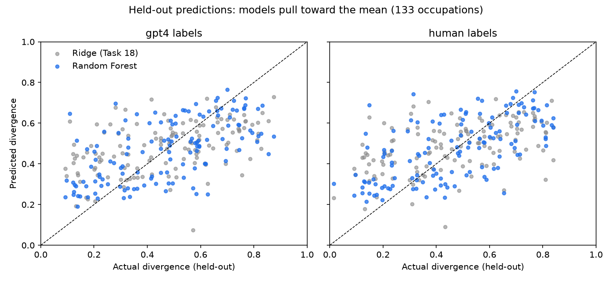

# Task 19 — Random Forest

## Setup

Same inputs, split and preprocessing as Task 18: `modeling_table.csv`, its saved
`split` column (530 train, 133 test), the 40 Task 17 features only, and median
imputation fit on training data. Random Forests need no scaling. Each forest has
300 trees and `random_state=42`.

Tuning used 5-fold CV on training occupations only, minimizing squared error over
20 settings:

- `max_features` (features considered per split): sqrt (about 6), 0.33, 0.5, 1.0.
- `min_samples_leaf` (smallest leaf): 1, 3, 5, 10, 20.

The held-out set was used once, after tuning. CV R² is nested (the whole search
reruns inside each outer fold), so it is directly comparable with Task 18's ridge.

## Comparison (all 663 occupations)

| Target | Model | Test R² | Test RMSE | 5-fold CV R² (train) |
| --- | --- | ---: | ---: | ---: |
| gpt4 | mean_baseline | -0.000 | 0.213 | -0.011 ± 0.015 |
| gpt4 | ols | 0.152 | 0.196 | 0.303 ± 0.035 |
| gpt4 | ridge | 0.195 | 0.191 | 0.305 ± 0.042 |
| gpt4 | random_forest | 0.360 | 0.171 | 0.542 ± 0.097 |
| human | mean_baseline | -0.001 | 0.215 | -0.009 ± 0.008 |
| human | ols | 0.178 | 0.195 | 0.279 ± 0.052 |
| human | ridge | 0.208 | 0.191 | 0.291 ± 0.057 |
| human | random_forest | 0.364 | 0.171 | 0.526 ± 0.110 |

## Sensitivity: 650 complete-feature occupations

| Target | Model | Test R² | Test RMSE | 5-fold CV R² (train) |
| --- | --- | ---: | ---: | ---: |
| gpt4 | mean_baseline | -0.000 | 0.214 | -0.011 ± 0.014 |
| gpt4 | ols | 0.152 | 0.197 | 0.271 ± 0.137 |
| gpt4 | ridge | 0.195 | 0.192 | 0.281 ± 0.116 |
| gpt4 | random_forest | 0.370 | 0.170 | 0.513 ± 0.089 |
| human | mean_baseline | -0.002 | 0.216 | -0.005 ± 0.006 |
| human | ols | 0.178 | 0.195 | 0.260 ± 0.133 |
| human | ridge | 0.215 | 0.191 | 0.271 ± 0.105 |
| human | random_forest | 0.375 | 0.170 | 0.506 ± 0.082 |

## Chosen settings

Task 20 should refit with these settings and `random_state=42` rather than retune.
They are also saved in `task19_rf_best_params.csv`.

| Target | Sample | max_features | min_samples_leaf | At grid edge |
| --- | --- | --- | ---: | --- |
| gpt4 | all_663 | 0.5 | 1 | min_samples_leaf |
| human | all_663 | 0.5 | 1 | min_samples_leaf |
| gpt4 | complete_650 | sqrt | 1 | max_features;min_samples_leaf |
| human | complete_650 | 0.33 | 1 | min_samples_leaf |

`min_samples_leaf=1` is the smallest possible value, so sitting at that edge
means the forest prefers fully grown trees, not that the grid was too narrow.

## Reading the results

R² is the share of variance in cross-index disagreement explained; RMSE is in
percentile-rank points. With 133 held-out occupations, differences of a few
hundredths in R² between models are within noise; compare against the CV
spread before calling a winner.

The Random Forest's R² gain over ridge (gpt4: +0.16 held-out, +0.24 CV; human: +0.16 held-out, +0.24 CV) appears in both the held-out
set and nested CV, and exceeds the CV spread, so non-linear structure in the
features adds real signal. Every model, ridge included, scores lower on the
held-out set than in CV, which points to a harder held-out sample rather than
forest overfitting. No two complete occupations share an identical feature
vector, so the forest is not matching duplicated O*NET profiles across the split.

These are associations, not causes, and disagreement is not predicted job loss.
Task 20's permutation importance will show which features carry the signal.

## Reproduction

Run `python3 notebooks/task19_random_forest.py` after Task 18. Writes only
`task19_model_comparison.csv`, `task19_rf_best_params.csv`, this note and
`figures/task19_predicted_vs_actual.png`.
